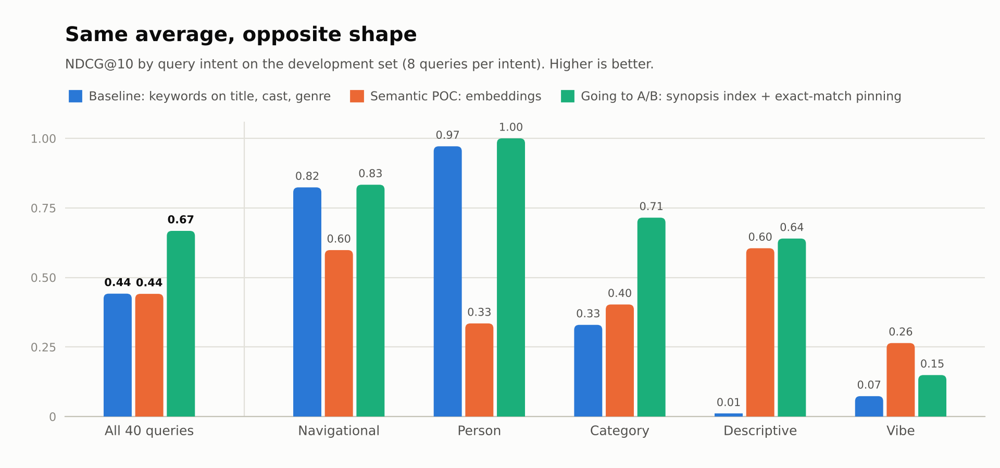

# discovery-search-evals

An offline evaluation harness for a search POC, built the way I would want one handed to me before anyone asks for an A/B slot.

The question it answers: **should a natural-language ("semantic") search candidate go to an online test against today's keyword search?** The answer it gave was no, and it pointed at a cheaper change that should.

Write-up: [The eval that told me not to A/B test my own POC](post/2026-10-07-evals-before-ab-tests.md)



## What is in here

| Piece | Where | What it is |
|---|---|---|
| Catalog | `data/catalog.jsonl` | 5,065 films (2000 to 2023) with title, cast, genres and a synopsis, from a public Wikipedia dataset |
| Golden set | `data/queries.yaml`, `data/queries_heldout.yaml` | 60 queries across five intents, each with a one-line rubric. 40 for development, 20 held out |
| Judgments | `data/qrels.tsv` | 2,241 graded (query, title) pairs: 0 not relevant, 1 acceptable, 2 exactly right |
| Systems | `evals/retrievers.py` | Six rankers behind one `search(query, k)` interface |
| Ship gates | `gates.yaml` | What a candidate must clear to earn an A/B test, written before the first run |
| Results | `results/` | Summary tables, per-query scores, raw rankings, failure reports, the chart |
| Error analysis | `analysis/failure_tags.yaml` | A root cause for every failing development query |

## The systems

| Name | What it does |
|---|---|
| `keyword_meta` | **Baseline.** BM25 over title, cast and genre. What catalog search usually is |
| `keyword_full` | The same engine with the synopsis indexed too |
| `semantic` | **The POC.** Embedding retrieval over title, genre and synopsis |
| `hybrid` | Reciprocal rank fusion of `keyword_full` and `semantic` |
| `keyword_pinned` | `keyword_full` behind a known-item guard: a query that is exactly a title or an actor's name pins those titles first |
| `hybrid_pinned` | `hybrid` behind the same guard |

The embedding model is [WordLlama](https://github.com/dleemiller/WordLlama), a 16 MB static model that runs on a CPU with no API key. That is a deliberate choice so anyone can reproduce the numbers, and it is a POC-grade model. See "Swap the model" below.

## Results

Development set, 40 queries. Full tables: [`results/dev/summary.md`](results/dev/summary.md), [`results/heldout/summary.md`](results/heldout/summary.md).

| System | NDCG@10 | Change vs baseline (95% interval) | Title lookup Hit@1 | Clears every gate |
|---|---|---|---|---|
| `keyword_meta` (baseline) | 0.442 | | 0.750 | |
| `keyword_full` | 0.658 | +0.216 [+0.118, +0.326] | 0.500 | no |
| `semantic` | 0.441 | -0.001 [-0.161, +0.158] | 0.250 | no |
| `hybrid` | 0.607 | +0.165 [+0.049, +0.285] | 0.250 | no |
| `keyword_pinned` | 0.667 | +0.226 [+0.128, +0.335] | 0.750 | **yes** |
| `hybrid_pinned` | 0.673 | +0.231 [+0.138, +0.331] | 0.750 | **yes** |

Three things the table says:

1. **The POC ties the baseline on average and that average is meaningless.** `semantic` gains 0.60 NDCG on plot-description queries and loses 0.64 on actor lookups. The two cancel.
2. **The cheap fix beats the model.** Indexing the synopsis with the existing keyword engine is worth +0.216. It also breaks title lookup, which is why it does not pass on its own.
3. **With the guard in place, the model adds nothing measurable.** `hybrid_pinned` against `keyword_pinned`: +0.006 [-0.036, +0.048] on the development set and -0.021 [-0.121, +0.045] on the held-out set.

On the 20 held-out queries, `keyword_pinned` clears every gate again (+0.129 [+0.045, +0.233] over baseline). It is the candidate named in `gates.yaml` as cleared for an online test.

## Run it

Python 3.10 to 3.13.

```bash
python -m venv .venv && source .venv/bin/activate
pip install -r requirements.txt

python -m evals.run        # both query sets, writes results/
python -m evals.failures   # failure report for the round 1 candidate
python -m evals.chart      # the chart above
python -m pytest -q        # unit tests, golden-set checks, and the ship gates
```

`make all` runs the lot. A full run of both query sets takes about ten seconds on a CPU. Nothing is downloaded at eval time.

## How the evaluation works

**Queries are sliced by intent.** Navigational (the person knows the title), person (an actor), category (a genre or sub-genre), descriptive (they remember the plot, not the title) and vibe (they want a feeling). Every table reports each slice, because the slices disagree.

**Judgments come from three places**, recorded in the `source` column of `qrels.tsv`:

- `cast` (293): actor queries are graded by rule from the cast list.
- `nominated` (852): titles the judge already knew were right or wrong for a query, added so recall is not limited to what the systems happened to find.
- `pooled` (1,096): the union of every system's top 10 for a query, shuffled, stripped of system names and graded blind against the rubric. `python -m evals.pool` builds that sheet.

**Unjudged results are tracked, not ignored.** An ungraded title scores as a miss, which quietly punishes any new system that surfaces something the old ones did not. The `Judged@10` column shows how much of each system's output has been graded, and a test fails if it drops below 98%.

**Every comparison carries an interval.** Differences are reported with a 95% paired bootstrap over queries. With 40 queries, a difference in means on its own is not evidence.

**The gates are code.** `gates.yaml` holds three rules: beat the baseline with the whole interval above zero, never be worse at title lookup, and stay within 0.02 on actor lookups. `tests/test_decision.py` fails the build if the promoted candidate stops clearing them.

**The held-out set stays held out.** `queries_heldout.yaml` was written after round 1 and before the round 2 systems were run on anything. `evals.failures` only reads the development set, so nobody tunes against the held-out one by accident.

## Extend it

**Swap the model.** `load_embedder()` in `evals/retrievers.py` returns a function from a list of strings to a matrix. Replace it with any encoder or embeddings API, then:

```bash
python -m evals.pool                             # lists results nobody has graded yet
# fill in the grade column of judging/pool.tsv
python -m evals.pool --merge judging/pool.tsv
python -m evals.run
```

**Add a system.** Anything with `search(query, k) -> [(doc_id, score)]` can be added to `build_systems()`. The pool step above applies.

**Add queries.** Append to a query file with a slice and a rubric note, run the pool step, grade.

## Limits

- 60 queries is small. Per-slice numbers (8 queries, or 4 on the held-out set) are directional. Read the intervals.
- One judge. There is no inter-annotator agreement number, and the vibe rubrics in particular involve taste.
- The embedding model is small and static. A stronger encoder may change the verdict on `semantic`. It will not change the gates.
- Offline relevance is not engagement. Clearing these gates earns an online test. It does not replace one.

## Data

The catalog is a filtered subset of [prust/wikipedia-movie-data](https://github.com/prust/wikipedia-movie-data), pinned to a commit in `scripts/build_catalog.py`. Synopsis text comes from Wikipedia and is licensed CC BY-SA 4.0. Details in [`data/README.md`](data/README.md).
